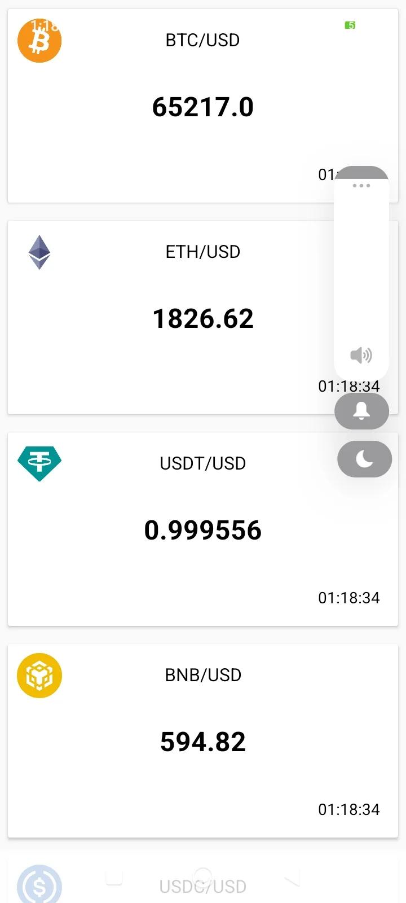
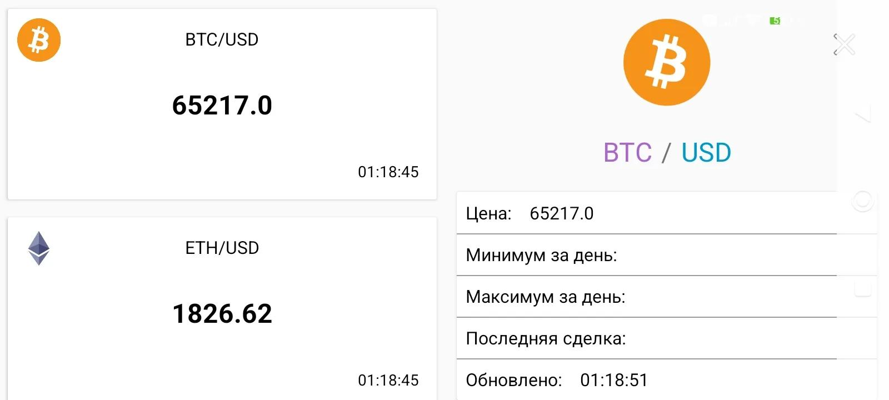

# CryptoApp

Android-приложение для просмотра курсов криптовалют. Загружает данные с CoinGecko Demo API, сохраняет их в Room и отображает в списке с возможностью открыть детали монеты. Поддерживает портретную и ландшафтную ориентации (master-detail).

## Скриншоты

### Портретная ориентация



### Ландшафтная ориентация



## Возможности

- Список топ-50 криптовалют с ценой, символом и логотипом.
- Детальный экран монеты: цена, символ, логотип, время обновления.
- Master-detail: в портрете — список на весь экран и детали поверх; в ландшафте — список и детали рядом.
- Кнопка «Закрыть» на экране деталей и обработка кнопки «Назад».
- Кеширование данных в Room (список сохраняется между запусками).
- Автоматическая загрузка данных при старте (с периодическим обновлением).
- ViewBinding вместо findViewById и Kotlin synthetics.
- ListAdapter + DiffUtil вместо notifyDataSetChanged.

## Стек

- Язык: Kotlin 2.1.10
- Сборка: AGP 8.8.0, Gradle 8.10.2
- compileSdk: 35, minSdk: 21, targetSdk: 35
- Архитектура: Clean Architecture (data / domain / presentation), MVVM
- Сеть: Retrofit 2 + Gson, suspend-функции (корутины)
- БД: Room 2.6.1 (KSP), LiveData, suspend-функции в DAO
- Асинхронность: Kotlin Coroutines, viewModelScope, lifecycleScope
- UI: ViewBinding, RecyclerView, Picasso, Material Components
- API: CoinGecko Demo API (coins/markets)

## Структура проекта

```
com.example.cryptoapp
│
├── api
│   ├── ApiFactory.kt              (Retrofit + Gson, BASE_URL)
│   ├── ApiService.kt              (suspend-эндпоинт CoinGecko, ключ через BuildConfig)
│   └── dto
│       └── CoinGeckoDto.kt        (DTO ответа CoinGecko)
│
├── data
│   ├── database
│   │   ├── AppDatabase.kt         (RoomDatabase, fallbackToDestructiveMigration)
│   │   ├── CoinPriceInfoDao.kt    (DAO: LiveData + suspend insert)
│   │   └── CoinPriceInfoDbModel.kt (@Entity)
│   ├── mapper
│   │   └── CoinPriceInfoMapper.kt (DTO <-> DbModel <-> Domain)
│   └── repository
│       └── CoinRepositoryImpl.kt  (сеть + БД + маппер)
│
├── domain
│   ├── CoinPriceInfo.kt           (domain-модель, без @Entity и @SerializedName)
│   ├── repository
│   │   └── CoinRepository.kt      (интерфейс репозитория)
│   └── usecase
│       ├── GetPriceListUseCase.kt
│       ├── GetDetailInfoUseCase.kt
│       └── LoadDataUseCase.kt
│
└── presentation
    ├── MainActivity.kt            (host для master-detail)
    ├── CoinViewModel.kt           (LiveData + UseCase, без сети и БД)
    ├── CoinInfoAdapter.kt         (ListAdapter + DiffUtil + ViewBinding)
    ├── CoinPriceListFragment.kt   (список)
    └── CoinDetailFragment.kt      (детали + кнопка «Закрыть»)
```

## Сборка и запуск

1. Откройте проект в Android Studio (актуальная версия).
2. Дождитесь окончания Gradle Sync.
3. Запустите приложение на эмуляторе или устройстве (Run).

### API-ключ CoinGecko

Приложение использует CoinGecko Demo API. Ключ не хранится в коде — он читается из local.properties и попадает в BuildConfig.COINGECKO_API_KEY.

1. Зарегистрируйтесь на coingecko.com и получите Demo API-ключ в Developer Dashboard.
2. В корне проекта откройте local.properties (или создайте, если его нет) и добавьте строку:
   COINGECKO_API_KEY=ваш_ключ
3. local.properties уже в .gitignore — ключ не попадёт в репозиторий.
4. В app/build.gradle ключ читается и передаётся в buildConfigField, а в ApiService используется BuildConfig.COINGECKO_API_KEY.

### Примечание о версиях

Проект изначально использовал CryptoCompare API, RxJava и Activity для списка/деталей. В ходе рефакторинга:

- Сеть: CryptoCompare -> CoinGecko Demo API, RxJava -> корутины (suspend).
- БД: Room с @Entity на DTO -> отдельный CoinPriceInfoDbModel, suspend-вставка.
- Архитектура: плоская структура -> Clean Architecture (data / domain / presentation), UseCase, маппер.
- UI: две Activity -> master-detail фрагменты, findViewById -> ViewBinding, notifyDataSetChanged -> ListAdapter + DiffUtil.
- Ключ API: хардкод -> local.properties + BuildConfig.

## Лицензия

Исходный код основан на учебных материалах курса. Рефакторинг под Clean Architecture, замена API на CoinGecko Demo API, переход на корутины и ViewBinding, а также доработка UI выполнены Вячеславом Дроновым. Проект предназначен для обучения.